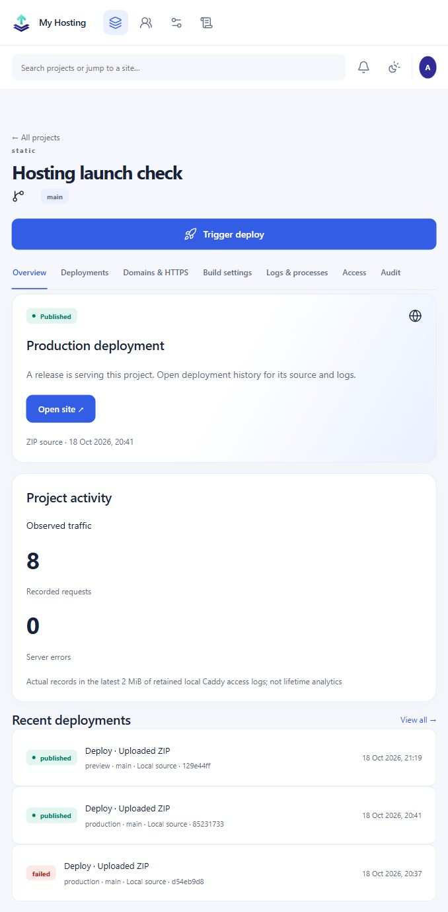
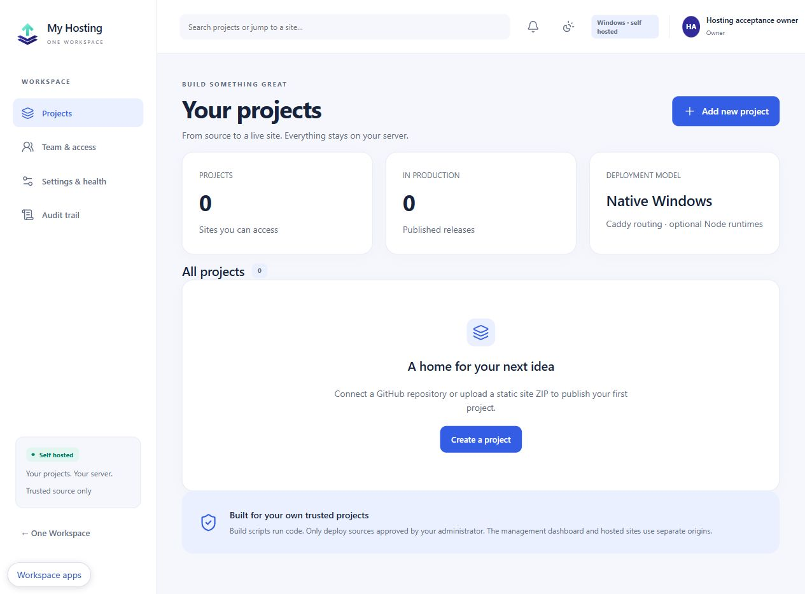

<p align="center"></p>
<h1 align="center">My Hosting</h1>
<p align="center">Your sites and apps. Your Windows server. One Workspace.</p>

**Windows preview · trusted administrators and project sources.** Native Go,
SQLite and a branded React dashboard, with managed Caddy and optional Node
runtimes. No Docker or external database. This is an original repository,
not a fork of Netlify, Coolify, Dokploy or Caddy.

[Downloads](https://github.com/oneworkspacestudio/my-hosting/releases) ·
[Install and recover](docs/OPERATIONS.md) · [API](docs/openapi.json) ·
[One Workspace](https://github.com/oneworkspacestudio/one-workspace)

## Deploy a project

Connect a GitHub repository or upload a site ZIP, select a static/Node/Next/Nuxt
adapter, follow a deployment's real log, and promote or restore retained artifacts.
MyAccounts uses normal OIDC discovery, authorization code, PKCE and nonce.
Standalone bootstrap is disabled when MyAccounts is configured.

Source and current acceptance plan: [implementation decisions](docs/IMPLEMENTATION.md).
The dashboard is authored in [AUI source](web/src/screens) and compiled to React.
The original [logo source and provenance](branding/README.md) follow the suite's
indigo, mint and silver icon family.



## Working features

- GitHub source pinned to an immutable SHA, scoped encrypted PATs, signed push
  webhooks and branch previews; ordinary ZIP uploads also work.
- Static sites, Node apps and tested Next/Nuxt native Windows configurations.
- Real streaming logs, retries, rebuilds, artifact republish, preview promotion,
  cancellation, atomic production switching and retained-release rollback.
- Managed runtimes with verified downloads/offline imports and repair, process
  supervision, crash backoff, WebSocket proxying and measured access-log traffic.
- Project permissions, write-only environment secrets, audit history, custom
  domain verification/canonical redirects, retention and encrypted backup/restore.
- One Workspace installer/catalog/icon integration and MyAccounts shared sign-in
  and logout. An existing Workspace session opens Hosting without another password.

Native acceptance covers actual Caddy/Node, Next and Nuxt builds, WebSocket frames,
crash restart, descendant cancellation, host/cross-project filesystem denial,
backup restore, OIDC validation and a fresh Workspace + MyAccounts installation.
See the [acceptance record](docs/ACCEPTANCE.md) for evidence and limits.

This is a preview: trusted sources only, one concurrent build, no managed
serverless functions, no GitHub App flow, no automatic preview/DNS expiry or
namespace migration. SCM services, unattended boot before sign-in, another Windows
machine and Windows Server Core have not been accepted. Existing installed apps
remain under the normal Workspace update/optional-app workflow.



## Security scope

The initial scope is **trusted administrators and trusted project sources**.
Project build scripts execute code. Windows low-integrity restricted tokens,
per-project ACLs and Job Objects are defense in depth, not a VM boundary or a
claim that untrusted multi-tenant hosting is safe. The implementation fails closed
if required restrictions cannot be applied or if builds would run as LocalSystem.
Private state needs a local NTFS directory. Hosted content uses separate origins;
Caddy's unauthenticated admin API is disabled; private control uses mutual TLS
on loopback with protected client credentials.

`MyHosting.exe` is the main launcher and contains the dashboard. Caddy and Node
are additional managed processes. Node is provisioned only for builds/server apps
that need it. Runtime archives are pinned to official versions and SHA-256 values.
No Docker or external database is required. The recommended tunnel connection
provides public HTTPS without inbound router ports. Direct Caddy HTTPS requires
DNS and reachable ports. Publication checks real HTTPS before reporting success.

## Your sites' addresses

The recommended free Workspace tunnel setup automatically publishes sites at
`my-site-sites.your-domain.com` and previews at
`deploy-ID--my-site-sites.your-domain.com`. On the owner's connected zone this
is `my-site-sites.m8e.co.uk`. Other installations use their own domain and
Cloudflare connection. Optional direct HTTPS supports nested addresses such as
`my-site.sites.m8e.co.uk`. See [publishing and HTTPS](docs/PUBLISHING.md).

## Develop locally

Requirements: Go 1.27, Node supporting Vite 8, Windows and protected NTFS test
storage. Public source/dependency caches may use other volumes.

```powershell
cd web
npm ci
npm run build
cd ..
go test ./internal/hosting
go build -buildvcs=false -trimpath -o dist/MyHosting.exe ./cmd/myhosting
```

For the release ZIP, notices, dependency inventory and checksums, run
`scripts/build.ps1`. Set `MYHOSTING_RUNTIME_CACHE` and `MYHOSTING_SSR=1` to
include native runtime/framework checks. Test storage must be on NTFS.

Use a fresh synthetic installation for testing. Never test against an existing
Workspace/MyAccounts/FileBrowser data directory. Build and release locally;
GitHub Actions are deliberately not used in this organization workflow.

## Licences

Original application and artwork: Apache-2.0. Caddy is a separately managed
Apache-2.0 dependency; Node and npm have their own included notices. React, Vite,
AUI compiler, Lucide, SQLite and Go dependencies retain their licences. See
[NOTICE](NOTICE); the release dependency inventory is generated during packaging.
